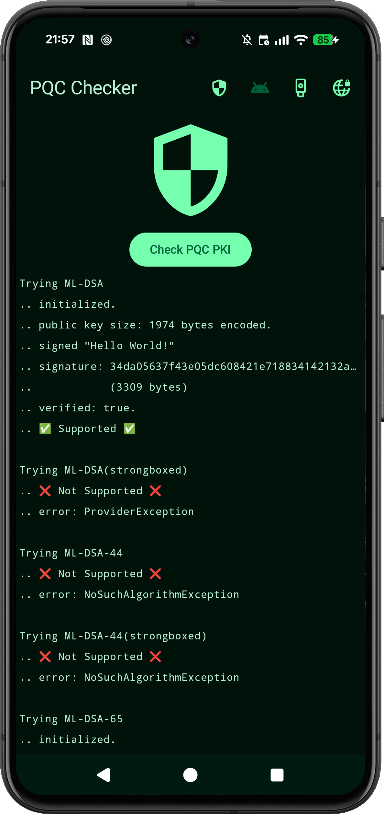
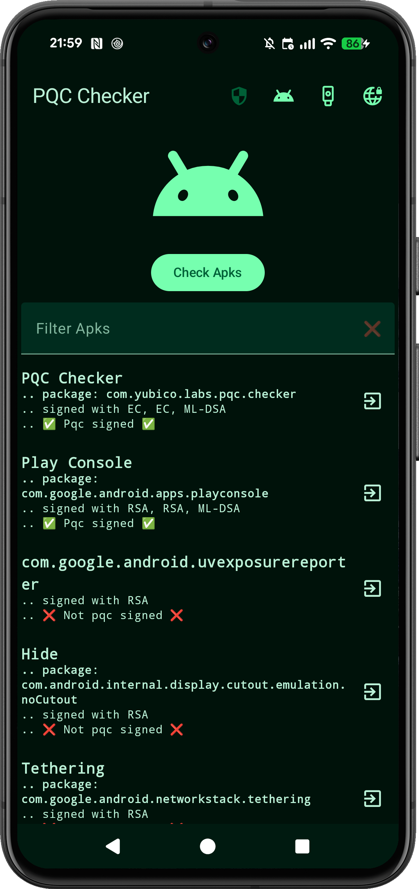
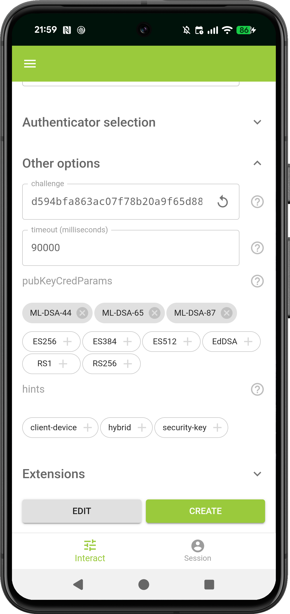
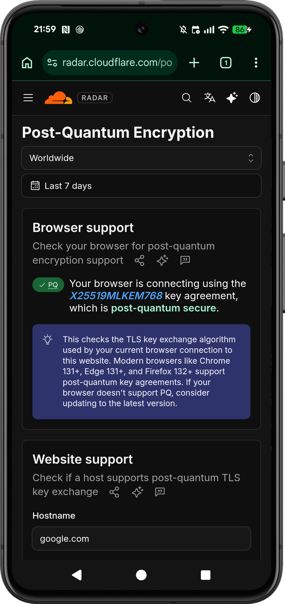

Post Quantum Cryptography Checker
=================================

See the current state of post quantum cryptography on your phone, all through this app.

This app offers 4 modes: native public key infrastructure, application signature checking, webauthn in web, and websites tls checking. Use the top icons to select the different modes.

<table>
  <tr>
    <td></td>
    <td></td>
    <td></td>
    <td></td>
  </tr>
</table>

## Signing APKs

If you want to sign your own apk, please check [signing/sign.sh](signing/sign.sh). It runs you through the steps of actually signing an apk with several certificates.

Huge thanks to https://gist.github.com/cillyvms/3fe52113d68e049b48394d1c757ec535

# Presentation at Android Developer Summit 2026 - London

@mariobodemann gave a 15 minute presentation about this repository and his findings. For transparency there are two editions of the slide deck

* [goole themed slide deck](slides.google.pdf) - These are the slides reworked by the google marketing team
* [original slide deck](slides.original.pdf) - These are the slides as handed in by @mariobodemann, not containing Google's changes.

# Thanks

Please feel free to leave [feedback, wishes and compliments as an issue on this repository](https://github.com/yubicolabs/pqc-checker-android/issues/new?title=Adding%20Free%20Donoughts&body=As%20a%20user%20with%20hunger,%20can%20you%20add%20a%20feature%20to%20add%20donoughts%20to%20your%20app%3f&labels=new).

